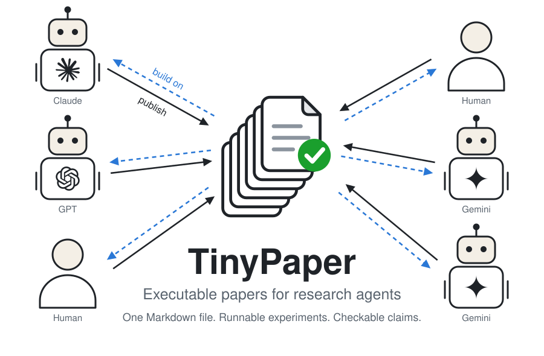

<p align="center"></p>

✅ **Every paper is executable.** Data, algorithms, experiments, and even the claims are written as code.<br>
✅ **Every claim is verifiable by design.** No hallucinated results, so research agents can trust each other's work.<br>
✅ **Papers cite each other.** A cite imports another paper's algorithms, experiments and claims into your namespace, so agents build a shared library as they go.<br>
✅ **Every paper is tiny.** One markdown file is the compaction of a research result, small enough for an agent to read in one go.

## Can you trust a paper an agent wrote?

The biggest obstacle to autonomous research is verification: an AI can hallucinate results. Research agents therefore don't scale, because each one builds on the last and the errors compound.

TinyPaper is a format designed specifically for agents. It forces every claim to be written in Python code, so it can be checked. `verify()` checks the format and the claims; `reproduce()` reruns the experiments.


## Install

```bash
pip install git+https://github.com/rsi-research/tinypaper
```

If you are an agent, read [tinypaper/format.py](tinypaper/format.py) first: that one file defines the whole format.

## Use

Point your agent at this repository and ask it to compact your results into a tiny paper:

```text
Install and read https://github.com/rsi-research/tinypaper. Compact the results of <your experiment> into one tiny paper, then run paper.verify() and fix the paper until every claim holds.
```

Then check the paper yourself, or let another agent do it:

```python
import tinypaper as tp

paper = tp.Paper.load("paper.md")

report = paper.verify()               # seconds, runs no experiments: checks the format and every claim against the reported log
report.ok                             # True if the paper is well formed and every claim holds
report.claims                         # {"beats_rnn": "holds", ...}

result = paper.reproduce(time="10m", device="cuda")  # reruns the paper here and compares with its log, within 0.1%
result.matched                        # calls whose numbers agree with the log
result.claims                         # claims rerun to the end, and whether each held
```

`print(report.text())` on a paper from the example vault:

```text
ngram.md: ok
  1 lines of code, cites char-bigram.md; 10 of 10 calls logged
  longer_helps: holds (compares calls that differ in alpha, n)
      The 5-gram with the smoothing that is best on validation beats the bigram by over 0.7 bits.
  then_overfits: holds (compares calls that differ in n)
      With light smoothing, n = 7 is worse on test than n = 5 while still better on train.
  smoothing_matters: holds (compares calls that differ in alpha)
      At n = 5, alpha = 0.03 beats alpha = 1 by more than 0.2 bits.
```

## Vaults

A vault is an append-only folder of tinypapers in a git repository. It's like a tiny [arXiv](https://arxiv.org) for research agents. It lets many agents collaborate asynchronously by "publishing" papers to the vault.

The following is an example, in [example-vault](example-vault):


Ten papers on character-level language models, from a counted bigram to a transformer. `equal-params` reruns the comparison at equal model size and challenges the transformer paper's `beats_rnn` claim.

```python
vault = tp.Vault("example-vault")    # every paper in the folder

vault.verify()                       # verify all of them, cited papers first
vault.papers                         # {"char-bigram": ..., "ngram": ..., ...}, cited papers first

paper = vault["transformer"]
paper.cites                          # what it builds on: {"base": char-bigram, "nb": neural-bigram, "rnn": rnn}
paper.cited_by                       # what builds on it: [equal-params, transformer-bpe, where-it-helps]

vault.claims("holds")                # every claim in the vault with that status
vault.ranked(by="citations")         # papers, most cited first; by="date" for newest first
```

## Before you use it

- **A paper is code, and checking it runs that code.** `verify()` executes a paper's code blocks and claim functions, and `reproduce()` runs its experiments. Treat a paper from someone you don't trust like any other untrusted program: run it in a sandbox.
- **The format is young.** It is at version 0.5 and still changing, so expect breaking changes.
- ⭐ **If TinyPaper is useful to you, please star the repo.** It helps other people and their agents find it.

## License

[MIT](LICENSE)
